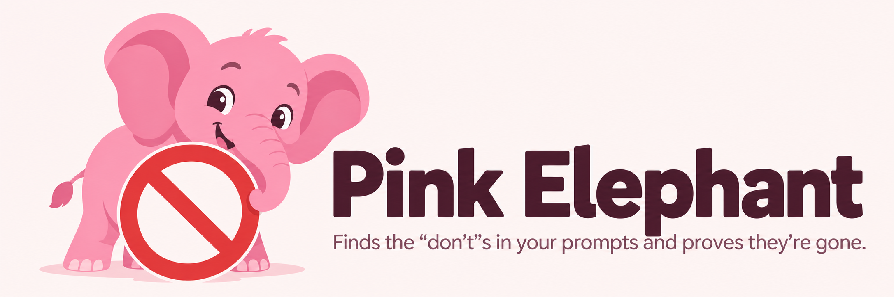
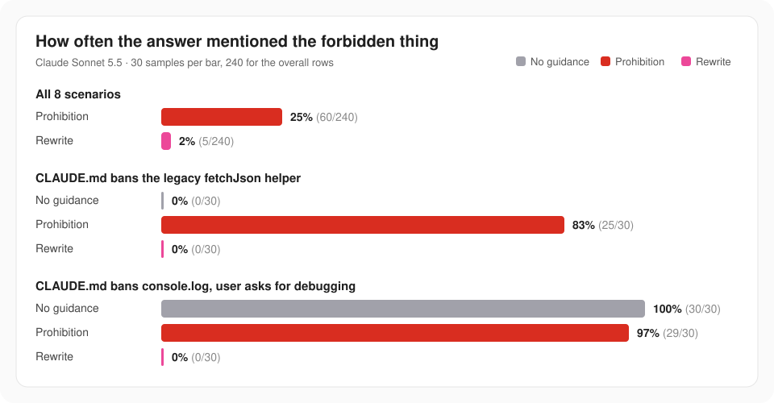
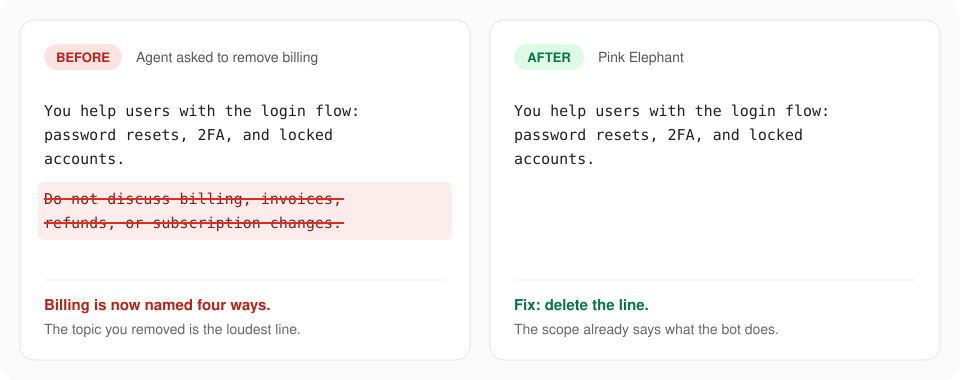
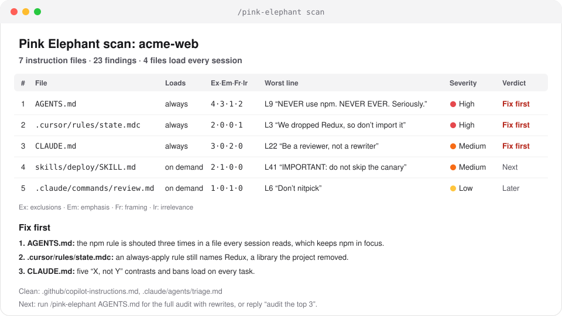

<p align="center">
  
</p>

<h1 align="center">Pink Elephant</h1>

<p align="center"><em>Tell your agent not to mention billing. Watch it mention billing.</em></p>

<p align="center">
  <a href="https://github.com/shahshrey/pink-elephant/stargazers"></a>
  <a href="https://github.com/shahshrey/pink-elephant/releases"></a>
  <a href="INSTALL.md"></a>
  <a href="https://skills.sh/shahshrey/pink-elephant"></a>
  <a href="LICENSE"></a>
</p>

<p align="center">
  <strong>92% fewer mentions of the forbidden thing &middot; 12% shorter prompts.</strong><br>
  <strong>With a "do not" line, the model brought it up in 25% of answers. After the rewrite, 2%.</strong><br>
  <strong>It rewrites, too.</strong> 93% of audited files stated every instruction positively, against 7% without the skill.
</p>

<p align="center"><sub>From our evals, run on Claude Sonnet 5.5 through Claude Code. <a href="#numbers">Details</a> &middot; <a href="evals/benchmarks/downstream.md">Results</a> &middot; <a href="evals/README.md#the-mention-rate-benchmark">Method</a></sub></p>

<p align="center">Using Pink Elephant at work? <a href="https://github.com/shahshrey/pink-elephant/issues/new?title=How%20I%20use%20Pink%20Elephant">Tell us your story</a></p>

---

Don't think of a pink elephant. You just did. So does your model. To avoid the thing a prompt names, it has to hold that thing in mind, and the thing leaks out.

It gets worse when you ask an agent to *remove* something. It writes "Do not do X" where X used to be, or "runs independently of X", and the elephant you wanted gone becomes the loudest line in the file.

Pink Elephant finds those lines in your prompts, skills, `CLAUDE.md`, `AGENTS.md`, and rules, rewrites them as instructions that describe what you want, and then proves the rewrite is clean with a reader who has never heard of the elephant.

## Numbers

<p align="center"></p>

Two scenarios carry the story. The model never mentioned the legacy helper until the prompt told it not to, and then it did in 83% of answers. With `console.log`, the model reaches for it by default; the ban barely moves it. Naming the alternative, `log.debug` from the project's logger, takes it to zero.

**Shorter, too.** Deleting is the default fix, so the files get smaller. In our evals, Pink Elephant's rewrites came out 12% shorter. Agents asked to fix the same files without it made them longer, mostly by adding "do not" lines. A system prompt, `CLAUDE.md`, or always-on rule is paid for on every turn, so the saving repeats for the life of the file. Fewer violations should also mean fewer correction turns, though that part isn't measured. Answer length stays about the same.

Now the caveats. Most of the effect comes from those two coding scenarios. In the rebrand scenario the rewrite did worse than the prohibition. The banned-words, shouting, and em-dash scenarios showed no mentions in any version, so they say nothing either way.

<details>
<summary>Every scenario</summary>

| Scenario | Prohibition | Rewrite | No guidance |
| --- | --- | --- | --- |
| `CLAUDE.md` bans the legacy `fetchJson` helper | 25/30 | 0/30 | 0/30 |
| `CLAUDE.md` bans `console.log`, user asks for debugging | 29/30 | 0/30 | 30/30 |
| Support bot told not to discuss billing | 4/30 | 0/30 | 0/30 |
| Sales assistant told not to mention competitors | 1/30 | 0/30 | - |
| Help widget told not to use the product's old name | 1/30 | 5/30 | - |
| Banned-words list, shouting `AGENTS.md`, em-dash ban | 0/90 | 0/90 | 0/60 |

On the five scenarios that have a no-guidance version: 39% with the prohibition, 0% with the rewrite, 20% with no guidance. The full tables are in [evals/benchmarks/downstream.md](evals/benchmarks/downstream.md).

</details>

## Before / after

<p align="center"></p>

You asked an agent to take billing out of a support bot. It wrote "Do not discuss billing, invoices, refunds, or subscription changes." Billing is now named four ways. Pink Elephant deletes the line, because the scope above it already says what the bot does.

More rewrites, one per pattern, in [examples.md](skills/pink-elephant/examples.md).

## Scan your whole repo

`/pink-elephant scan` reads every instruction file in the repo, finds the ones that load into every session, and ranks what to fix first. It changes nothing.

<p align="center"></p>

## What it catches

| Pattern | Looks like |
| --- | --- |
| Leftovers from a removal | "Do not discuss billing" in a bot that no longer does billing |
| Disguised negation | "OAuth publishing runs independently of cookie health" |
| Escalation | "NEVER run tests. NEVER EVER. DO NOT RUN TESTS." |
| Corrective framing | "Be a reviewer, not a rewriter" |
| Banned-word lists | "Never use: delve, tapestry, leverage..." |
| Change narration | "Instead of handling payments, this bot now focuses on login" |

## How it works

1. **Hunt.** Four subagents read your text in parallel, each looking for one kind of problem: exclusions in any grammar, emphasis and repetition, framing that names the unwanted alternative, and content outside the text's job.
2. **Classify.** Each finding becomes **Delete**, **Reframe**, **Move to a verifier**, or **Keep**. A reframe states the real target with a number or a named alternative. Banned lists move to a check that runs after generation.
3. **Rewrite** in place. Removed sections are rebuilt from a brief of what the text covers now, so nothing points at the gap.
4. **Verify.** Two fresh subagents check the result in parallel. The **blind reader** sees only the rewrite and reports what the text seems to be guarding against; if it names the elephant, the elephant is still in the room. The **leak hunter** gets the list of removed concepts and checks for synonyms, change narration, and empty structure.
5. **Loop** until both come back clean, up to three rounds, then **report** every finding with its rewrite.

The blind reader is the part I like most. You can't check your own rewrite for the thing you removed, because you know what you removed. A reader who was never told can't be primed into seeing it, so whatever it notices, the next model will notice too.

**Ruthless with elephants, gentle with guardrails.** "Ask before force-pushing, because it rewrites shared history" has no positive form, so it stays. The audit states it once, calmly, with the reason and a fallback.

## The prompt

Pink Elephant is one prompt, [SKILL.md](skills/pink-elephant/SKILL.md), with the subagent prompts in [hunters.md](skills/pink-elephant/hunters.md) and the lite and scan modes in [modes.md](skills/pink-elephant/modes.md). The compact version, for agents that read a rules file, is [AGENTS.md](AGENTS.md). Everything else in this repo loads one of those into different agents.

## Install

**Claude Code**, as two separate prompts:

```
/plugin marketplace add shahshrey/pink-elephant
```

```
/plugin install pink-elephant@pink-elephant
```

**Codex:**

```bash
codex plugin marketplace add shahshrey/pink-elephant
codex plugin add pink-elephant@pink-elephant
```

**Cursor:**

```bash
git clone https://github.com/shahshrey/pink-elephant ~/.cursor/skills/pink-elephant
```

**Any other agent:** `npx skills add shahshrey/pink-elephant --skill pink-elephant` installs it for Windsurf, Cline, Kiro, OpenCode, and the rest of the [skills CLI](https://skills.sh) list. Copilot CLI, Gemini CLI, Pi, Kimi Code, Qoder, Antigravity, Hermes, Devin, Grok Build, Goose, and OpenClaw each have a one- or two-line install in **[INSTALL.md](INSTALL.md)**, which also marks which routes have been run end to end.

That's the whole install. The elephant has left the room.

It runs when you call it by name. It works best in agents with a subagent tool, such as `Task` in Cursor and Claude Code. Elsewhere each reviewer runs as its own pass. Want the habit without the audit? Copy [AGENTS.md](AGENTS.md) into your project. It's five bullet points that load every session and teach your agent to write instructions this way the first time. Ready-made rule files for Cursor, Windsurf, Cline, Kiro, Copilot, Qoder, and Antigravity are listed in [INSTALL.md](INSTALL.md#companion-rule).

Only install Pink Elephant from [`shahshrey/pink-elephant`](https://github.com/shahshrey/pink-elephant) on GitHub. It's all Markdown and manifest files. There are no binaries and no lifecycle hooks, and the only code is a ten-line loader for Hermes.

## Commands

| Command | What it does |
| --- | --- |
| `/pink-elephant <file>` | Full audit: four parallel hunters, rewrite, blind reader and leak hunter, up to three rounds. Edits the file and reports every change. |
| `/pink-elephant lite <file>` | One cheaper pass in the current session with a single self-check. Good for drafts; use the full audit for prompts that ship. |
| `/pink-elephant scan [path]` | Read-only triage of every instruction file under the path, ranked by severity, with a "Fix first" verdict. |

The full and lite audits also take pasted text in place of a file. Plugin hosts namespace the command: `/pink-elephant:pink-elephant` in Claude Code, `$pink-elephant` in Codex.

## FAQ

**Isn't "never" sometimes right?**
Yes, and the audit agrees. Irreversible actions, security, privacy, legal limits, and hard API limits are classified **Keep**. They survive, stated once, next to the instruction they guard, with a reason and a fallback.

**Why subagents instead of a regex?**
"Does not depend on cookie health." "Runs independently of cookie health." "Cookie state is irrelevant here." Same sentence, three wordings. A regex catches one. A reader catches all three.

**Does it work without subagents?**
Yes. Each hunter runs as its own pass in the same session. You get the same result, just slower. Or run `lite` for a single quick pass.

**Will it touch files I didn't point it at?**
It edits the file you name, and `scan` edits nothing. The evals plant a FAQ full of prohibitions next to every target file; a run that changes it fails.

**Will it make my prompt longer?**
Shorter. Delete is the default for leftovers, change narration, and statements that two things are unrelated, so in our evals audited files came out 12% shorter. One calm sentence per rule is also easier for the next person to read than three shouted ones.

**Why "pink elephant"?**
Psychologists call it ironic process. Try to suppress a thought and it comes back. Daniel Wegner used a white bear. Ours is pink.

## Evals

The test suite lives in [evals/](evals/). It has 7 hand-built cases. Each one comes with an oracle rewrite and a *near miss*, the plausible wrong rewrite a careless agent produces, like rewording "unrelated to seed data" as "seed data is handled separately". Before any paid run, the grader checks itself. Every oracle has to pass, and every near miss has to fail on the checks it was built to trip. One case is a control where every prohibition is a real safety limit.

The same cases then run through Claude Code with and without the skill. Early results:

- Every check passed in 43% of runs with the skill and 14% without. The samples are still small, so I'd treat this as early.
- An LLM judge found instructions stated positively in 93% of rewrites with the skill and 7% without. It found no trace of the removed concepts in 43% with and 29% without.
- The runs with the skill missed the control case. The audit reworded the deploy freeze into an allowed deploy window and kept the times, the reason, and the fallback. The check expects that line untouched, so it failed.
- The trajectory check isn't measured yet.

[evals/README.md](evals/README.md) shows how to reproduce all of it.

## Contributing

New scenarios for the mention-rate benchmark and new eval cases are the most useful contributions. See [CONTRIBUTING.md](CONTRIBUTING.md).

## License

[MIT](LICENSE), by [Shrey Shah](https://github.com/shahshrey). The one place in this repo where shouting in capitals is legally required.

## Star History

[](https://star-history.com/#shahshrey/pink-elephant&Date)
